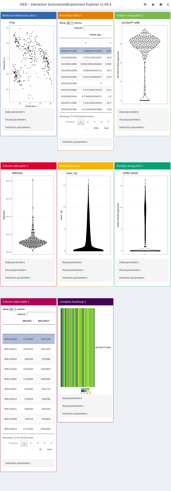

# Describing the ExperimentColorMap class

**Compiled date**: 2026-10-28

**Last edited**: 2018-03-08

**License**: MIT + file LICENSE

## Background

*[iSEE](https://bioconductor.org/packages/3.23/iSEE)* coordinates the
coloration in every plot via the `ExperimentColorMap` class
(Rue-Albrecht et al. 2018). Colors for samples or features are defined
from column or row metadata or assay values using “colormaps”. Each
colormap is a function that takes a single integer argument and returns
that number of distinct colors. The `ExperimentColorMap` is a container
that stores these functions for use within the
[`iSEE()`](https://isee.github.io/iSEE/reference/iSEE.md) function.
Users can define their own colormaps to customize coloration for
specific assays or covariates.

## Defining colormaps

### Colormaps for continuous variables

For continuous variables, the function will be asked to generate a
number of colors (21, by default). Interpolation will then be performed
internally to generate a color gradient. Users can use existing color
scales like
[`viridis::viridis`](https://sjmgarnier.github.io/viridisLite/reference/viridis.html)
or `heat.colors`:

\
`# Coloring for log-counts:`\
`logcounts_color_fun`` ``<-`` ``viridis``::`[`viridis`](https://sjmgarnier.github.io/viridisLite/reference/viridis.html)

It is also possible to use a function that completely ignores any
arguments, and simply returns a fixed number of interpolation points:

\
`# Coloring for FPKMs:`\
`fpkm_color_fun`` ``<-`` ``function``(``n``)``{`\
`    `[`c`](https://rdrr.io/r/base/c.html)`(``"black"``,``"brown"``,``"red"``,``"orange"``,``"yellow"``)`\
`}`

### Colormaps for categorical variables

For categorical variables, the function should accept the number of
levels and return a color per level. Colors are automatically assigned
to factor levels in the specified order of the levels.

\
`# Coloring for the 'driver' metadata variable.`\
`driver_color_fun`` ``<-`` ``function``(``n``)``{`\
`    ``RColorBrewer``::`[`brewer.pal`](https://rdrr.io/pkg/RColorBrewer/man/ColorBrewer.html)`(``n``, ``"Set2"``)`\
`}`

Alternatively, the function can ignore its arguments and simply return a
named vector of colors if users want to specify the color for each level
explicitly It is the user’s responsibility to ensure that all levels are
accounted for[^1]. For instance, the following colormap function will
only be compatible with factors of two levels, namely `"Y"` and `"N"`:

\
`# Coloring for the QC metadata variable:`\
`qc_color_fun`` ``<-`` ``function``(``n``)``{`\
`    ``qc_colors`` ``<-`` `[`c`](https://rdrr.io/r/base/c.html)`(``"forestgreen"``, ``"firebrick1"``)`\
`    `[`names`](https://rdrr.io/r/base/names.html)`(``qc_colors``)`` ``<-`` `[`c`](https://rdrr.io/r/base/c.html)`(``"Y"``, ``"N"``)`\
`    ``qc_colors`\
`}`

## The colormap hierarchy

### Specific and shared colormaps

Colormaps can be defined by users at three different levels:

- Each individual assay, column data field, and row data field can be
  assigned its own distinct colormap. Those colormaps are stored as
  named lists of functions in the `assays`, `colData`, and `rowData`
  slots, respectively, of the `ExperimentColorMap`. This can be useful
  to easily remember which assay is currently shown; to apply different
  color scale limits to assays that vary on different ranges of values;
  or display boolean information in an intuitive way, among many other
  scenarios.
- *Shared* colormaps can be defined for all assays, all column data, and
  all row data. These colormaps are stored in the `all_discrete` and
  `all_continuous` slots of the `ExperimentColorMap`, as lists of
  functions named `assays`, `colData`, and `rowData`.
- *Global* colormaps can be defined for all categorical or continuous
  data. Those two colormaps are stored in the `global_discrete` and
  `global_continuous` slots of the `ExperimentColorMap`.

### Searching for colors

When queried for a specific colormap of any type (assay, column data, or
row data), the following process takes place:

- A specific *individual* colormap is looked up in the appropriate slot
  of the `ExperimentColorMap`.
- If it is not found, the *shared* colormap of the appropriate slot is
  looked up, according to whether the data are categorical or
  continuous.
- If it is not found, the *global* colormap is looked up, according to
  whether the data are categorical or continuous.
- If none of the above colormaps were defined, the `ExperimentColorMap`
  will revert to the default colormaps.

By default, `viridis` is used as the default continuous colormap, and
`hcl` is used as the default categorical colormap.

## Creating the `ExperimentColorMap`

We store the set of colormap functions in an instance of the
`ExperimentColorMap` class. Named functions passed as `assays`,
`colData`, or `rowData` arguments will be used for coloring data in
those slots, respectively.

\
[`library`](https://rdrr.io/r/base/library.html)`(`[`iSEE`](https://isee.github.io/iSEE/)`)`\
`ecm`` ``<-`` `[`ExperimentColorMap`](https://isee.github.io/iSEE/reference/ExperimentColorMap-class.md)`(`\
`    assays ``=`` `[`list`](https://rdrr.io/r/base/list.html)`(`\
`        counts ``=`` ``heat.colors``,`\
`        logcounts ``=`` ``logcounts_color_fun``,`\
`        cufflinks_fpkm ``=`` ``fpkm_color_fun`\
`    ``)``,`\
`    colData ``=`` `[`list`](https://rdrr.io/r/base/list.html)`(`\
`        passes_qc_checks_s ``=`` ``qc_color_fun``,`\
`        driver_1_s ``=`` ``driver_color_fun`\
`    ``)``,`\
`    all_continuous ``=`` `[`list`](https://rdrr.io/r/base/list.html)`(`\
`        assays ``=`` ``viridis``::`[`plasma`](https://sjmgarnier.github.io/viridisLite/reference/viridis.html)\
`    ``)`\
`)`\
`ecm`\
`#> Class: ExperimentColorMap`\
`#> assays(3): counts logcounts cufflinks_fpkm`\
`#> colData(2): passes_qc_checks_s driver_1_s`\
`#> rowData(0):`\
`#> all_discrete(0):`\
`#> all_continuous(1): assays`

Users can change the defaults for all assays or column data by modifying
the *shared* colormaps. Similarly, users can modify the defaults for all
continuous or categorical data by modifying the global colormaps. This
is demonstrated below for the continuous variables:

\
[`ExperimentColorMap`](https://isee.github.io/iSEE/reference/ExperimentColorMap-class.md)`(`\
`    all_continuous``=`[`list`](https://rdrr.io/r/base/list.html)`(`` ``# shared`\
`        assays``=``viridis``::`[`plasma`](https://sjmgarnier.github.io/viridisLite/reference/viridis.html)`,`\
`        colData``=``viridis``::`[`inferno`](https://sjmgarnier.github.io/viridisLite/reference/viridis.html)\
`    ``)``,`\
`    global_continuous``=``viridis``::`[`magma`](https://sjmgarnier.github.io/viridisLite/reference/viridis.html)` ``# global`\
`)`\
`#> Class: ExperimentColorMap`\
`#> assays(0):`\
`#> colData(0):`\
`#> rowData(0):`\
`#> all_discrete(0):`\
`#> all_continuous(2): assays colData`\
`#> global_continuous(1)`

## Benefits

The `ExperimentColorMap` class offers the following major features:

- A single place to define flexible and lightweight sets of colormaps,
  that may be saved and reused across sessions and projects outside the
  app, to apply consistent coloring schemes across entire projects
- A simple interface through accessors
  `colDataColorMap(colormap, "coldata_name")` and setters
  `assayColorMap(colormap, "assay_name") <- colormap_function`
- An elegant fallback mechanism to consistently return a colormap, even
  for undefined covariates, including a default categorical and
  continuous colormap, respectively.
- Three levels of colormaps override: individual, shared within slot
  (i.e., `assays`, `colData`, `rowData`), or shared globally between all
  categorical or continuous data scales.

Detailed examples on the use of `ExperimentColorMap` objects are
available in the documentation
[`?ExperimentColorMap`](https://isee.github.io/iSEE/reference/ExperimentColorMap-class.md),
as well as below.

## Demonstration

Here, we use the `allen` single-cell RNA-seq data set to demonstrate the
use of the `ExperimentColorMap` class. Using the `sce` object that we
created
[previously](https://bioconductor.org/packages/3.23/iSEE/vignettes/basic.html),
we create an `iSEE` app with the `SingleCellExperiment` object and the
colormap generated above.

\
`app`` ``<-`` `[`iSEE`](https://isee.github.io/iSEE/reference/iSEE.md)`(``sce``, colormap ``=`` ``ecm``)`

We run this using `runApp` to open the app on our browser.

\
`shiny``::`[`runApp`](https://rdrr.io/pkg/shiny/man/runApp.html)`(``app``)`

Now, choose to color cells by `Column data` and select
`passes_qc_checks_s`. We will see that all cells that passed QC (`Y`)
are colored “forestgreen”, while the ones that didn’t pass are colored
firebrick.

If we color any plot by gene expression, we see that use of counts
follows the `heat.colors` coloring scheme; use of log-counts follows the
`viridis` coloring scheme; and use of FPKMs follows the black-to-yellow
scheme we defined in `fpkm_color_fun`.

## Session Info

\
[`sessionInfo`](https://rdrr.io/r/utils/sessionInfo.html)`(``)`\
`#> R version 4.6.1 (2026-06-24)`\
`#> Platform: x86_64-pc-linux-gnu`\
`#> Running under: Ubuntu 24.04.5 LTS`\
`#> `\
`#> Matrix products: default`\
`#> BLAS:   /usr/lib/x86_64-linux-gnu/openblas-pthread/libblas.so.3 `\
`#> LAPACK: /usr/lib/x86_64-linux-gnu/openblas-pthread/libopenblasp-r0.3.26.so;  LAPACK version 3.12.0`\
`#> `\
`#> locale:`\
`#>  [1] LC_CTYPE=en_US.UTF-8       LC_NUMERIC=C              `\
`#>  [3] LC_TIME=en_US.UTF-8        LC_COLLATE=en_US.UTF-8    `\
`#>  [5] LC_MONETARY=en_US.UTF-8    LC_MESSAGES=en_US.UTF-8   `\
`#>  [7] LC_PAPER=en_US.UTF-8       LC_NAME=C                 `\
`#>  [9] LC_ADDRESS=C               LC_TELEPHONE=C            `\
`#> [11] LC_MEASUREMENT=en_US.UTF-8 LC_IDENTIFICATION=C       `\
`#> `\
`#> time zone: UTC`\
`#> tzcode source: system (glibc)`\
`#> `\
`#> attached base packages:`\
`#> [1] stats4    stats     graphics  grDevices utils     datasets  methods  `\
`#> [8] base     `\
`#> `\
`#> other attached packages:`\
`#>  [1] iSEE_2.25.2                 SingleCellExperiment_1.34.0`\
`#>  [3] SummarizedExperiment_1.42.0 Biobase_2.72.0             `\
`#>  [5] GenomicRanges_1.64.0        Seqinfo_1.2.0              `\
`#>  [7] IRanges_2.46.0              S4Vectors_0.50.3           `\
`#>  [9] BiocGenerics_0.58.1         generics_0.1.4             `\
`#> [11] MatrixGenerics_1.24.0       matrixStats_1.5.0          `\
`#> [13] BiocStyle_2.40.0           `\
`#> `\
`#> loaded via a namespace (and not attached):`\
`#>  [1] gridExtra_2.3.1       rlang_1.3.0           magrittr_2.0.5       `\
`#>  [4] shinydashboard_0.7.3  clue_0.3-68           GetoptLong_1.1.1     `\
`#>  [7] otel_0.2.0            compiler_4.6.1        mgcv_1.9-4           `\
`#> [10] png_0.1-9             systemfonts_1.3.2     vctrs_0.7.3          `\
`#> [13] pkgconfig_2.0.3       shape_1.4.6.1         crayon_1.5.3         `\
`#> [16] fastmap_1.2.0         XVector_0.52.0        fontawesome_0.5.3    `\
`#> [19] promises_1.5.0        rmarkdown_2.32        shinyAce_0.4.4       `\
`#> [22] ragg_1.5.2            xfun_0.62             cachem_1.1.0         `\
`#> [25] jsonlite_2.0.0        listviewer_4.0.0      later_1.4.8          `\
`#> [28] DelayedArray_0.38.2   parallel_4.6.1        cluster_2.1.8.3      `\
`#> [31] R6_2.6.1              bslib_0.12.0          RColorBrewer_1.1-3   `\
`#> [34] jquerylib_0.1.4       Rcpp_1.1.2            bookdown_0.48        `\
`#> [37] iterators_1.0.14      knitr_1.52            httpuv_1.6.17        `\
`#> [40] Matrix_1.7-6          splines_4.6.1         igraph_2.3.4         `\
`#> [43] tidyselect_1.2.1      abind_1.4-8           yaml_2.3.12          `\
`#> [46] viridis_0.6.5         doParallel_1.0.17     codetools_0.2-20     `\
`#> [49] miniUI_0.1.2          lattice_0.23-1        tibble_3.3.1         `\
`#> [52] shiny_1.14.0          S7_0.2.2              evaluate_1.0.5       `\
`#> [55] desc_1.4.3            circlize_0.4.18       pillar_1.11.1        `\
`#> [58] BiocManager_1.30.27   DT_0.34.0             foreach_1.5.2        `\
`#> [61] shinyjs_2.1.1         ggplot2_4.0.3         scales_1.4.0         `\
`#> [64] xtable_1.8-8          glue_1.8.1            tools_4.6.1          `\
`#> [67] colourpicker_1.3.0    fs_2.1.0              grid_4.6.1           `\
`#> [70] colorspace_2.1-4      nlme_3.1-171          vipor_0.4.7          `\
`#> [73] cli_3.6.6             textshaping_1.0.5     S4Arrays_1.12.1      `\
`#> [76] viridisLite_0.4.3     ComplexHeatmap_2.28.0 dplyr_1.2.1          `\
`#> [79] gtable_0.3.6          rintrojs_0.3.4        sass_0.4.10          `\
`#> [82] digest_0.6.39         SparseArray_1.12.3    ggrepel_0.9.8        `\
`#> [85] rjson_0.2.23          htmlwidgets_1.6.4     farver_2.1.2         `\
`#> [88] memoise_2.0.1         htmltools_0.5.9       pkgdown_2.2.1        `\
`#> [91] lifecycle_1.0.5       shinyWidgets_0.9.1    GlobalOptions_0.1.4  `\
`#> [94] mime_0.13`\
`# devtools::session_info()`

## References

Rue-Albrecht, K., F. Marini, C. Soneson, and A. T. L. Lun. 2018. “iSEE:
Interactive SummarizedExperiment Explorer.” *F1000Research* 7 (June):
741.

[^1]: Needless to say, these functions should not be used as shared or
    global colormaps.
